# מרחיקים בנייה מהמחשב בלי לפגוע בבדיקות

תאריך: 1 בנובמבר 2026. מחקר ותכנון בלבד; לא הוקם שירות, לא הופעל build מבוקר, לא הועלה תוכן ולא שונו קוד ייצור, סקריפטי בנייה, נעילות או תורים.

## 1. תקציר מנהלים — Windows שלם הוא הפיילוט הקרוב ביותר, אך העלאת המשחק חסומה

**[מסקנה מבוססת מקור]** אפשר לתכנן הפרדה של קומפילציה וקישור מבדיקות המשחק המקומיות, אך אין היום מסלול remote מוכן ומותר לכל הפרויקט. המסלול הטכני הקרוב ביותר לקיים הוא עובד Windows עם אותו MSYS2/UCRT64, שמבצע compile וגם link ומחזיר ארטיפקטים מזוהים. **[מקור]** קוד AOT, objects ו־DLL נגזרים מהמשחק, ואף וריאנט UI של ה־EXE מטמיע music-plan שהסקריפט מסמן כ־game-derived; כללי הפרויקט אינם מתירים להעלות אותם לשירות חיצוני. **[נמדד/לא נמדד]** נאספה תצפית מערכת פסיבית, אך כל ששת תרחישי ה־build המבוקרים דולגו בבטחה; אין נתון אמפירי של peak compiler/linker או builds לשעה. **[אומדן]** 150 ₪ אינם מממנים Windows עתיר זיכרון פעיל תמיד במחירים שנבדקו; הם מממנים שימוש מוגבל לפי שעה, או מחיר קטלוג של Linux משותף שטרם הוכחו זמינותו ותאימותו. **[מקור]** `zw test` מקבל DLL בעל hash מפורש, אך EXE בנתיב חדש דורש מתאם עתידי ואסור להחליפו מעל הקובץ הקנוני. **[המלצה]** קודם לתאם מדידה מקומית מבוקרת ולסווג קלטים; אחר כך לבחון עובד Windows בבעלות תומר, עם הכנה מקומית מורשית של התוכן, לפני הפצה לריבוי עובדים או ניסוי ענן. ([כללים](../../AGENTS.md), [הטמעת UI](../../port/ui-v2/pc/build-pc-ui.sh), שורות 24–39; [שער EXE](../../tools/local-testing/worker.py), שורות 157–168.)

**מקרא ראיות:** **[נמדד]** הוא נתון שנאסף במחקר הנוכחי; **[מקור]** הוא קוד/תיעוד שנבדק, לרבות פלט version ונתוני מחיר ספק; **[היסטורי]** הוא דיווח קודם ללא benchmark חדש; **[הסקה]** היא מסקנה שטרם אושרה בניסוי; **[הצעה]** היא תכנון שלא מומש; **[לא אומת]** מציין פער. **[אומדן]** הוא חישוב עם הנחות מפורשות. מחיר מאומת אינו הוכחת זמינות בחשבון, תאימות, רישיון לכל קלט או ביצועים.

## 2. מסלול הבנייה בפועל — runtime, AOT ו־relink הם שלושה עומסים שונים

**[מקור/פלט כלי]** כלי Windows שנבדקו הם **Clang ו־LLD 21.1.7**, יעד `x86_64-w64-windows-gnu`, ו־GNU Make 4.4.1 בסביבת MSYS2 UCRT64. אין במסלול הליבה שנבדק שימוש ב־MSVC, MSBuild או CMake/Ninja. ה־runtime נמצא במאגר האח `pokeza-recomp-ps5`; orchestration ווריאנט UI נמצאים במאגר הנוכחי. Windows נשען על MinGW headers/import libraries, לא על הוכחה לצורך ב־MSVC Windows SDK. ([הוראות Windows](../../../pokeza-recomp-ps5/docs/BUILD-windows.md), [Makefile](../../../pokeza-recomp-ps5/Makefile), שורות 56–74, 153–179; [הוראות PC](../../port/ui-v2/pc/README-pc-build.md), שורות 15–47.)

| מסלול — [מקור] | כניסה קיימת | מה נבנה ותלות מרכזית |
|---|---|---|
| Full AOT | `make gen`, ואז מתכון README: `make -j16 B=build/o1 GENARCH=-march=x86-64-v3 GENOPT="-O1 -DGUEST_VOLATILE"` | generation מ־EXEFS main/sdk, generated C, runtime ו־DLL; זה אינו מתכון שאושר להרצה במחקר |
| runtime objects בלבד | `make runtime-objs` | runtime/backend/UI objects, ללא generated game code או link |
| PC runtime מבודד | `bash port/ui-v2/pc/build-pc-runtime.sh objects\|stub\|link\|stockname` | העתקת מקור, הכנת SDL, 64 runtime objects ו־helpers; פרטי targets אינם זהים |
| DLL relink | `bash port/ui-v2/pc/relink-game-dll.sh link` | שימוש ב־frozen AOT וב־import library קיימת, החלפת hook units ו־pc_compat |
| UI EXE מותאם | `build-pc-ui.sh` | C++20/UI/randomizer, generated fonts/capabilities ותוכנית מוזיקה; גם כתיבות source קיימות |

הכניסות והשלבים מאומתים ב־[Makefile](../../../pokeza-recomp-ps5/Makefile), שורות 208–305, ב־[wrapper](../../port/ui-v2/pc/build-pc-runtime.sh), שורות 120–188, ב־[relink](../../port/ui-v2/pc/relink-game-dll.sh), שורות 68–112, וב־[UI](../../port/ui-v2/pc/build-pc-ui.sh), שורות 16–70. טבלת פקודות זו מתעדת ממשקים; אינה הוראה להריצם ללא בידוד ותיאום.

**[מקור]** ה־EXE יוצר `lasrecomp.dll.a` ומייצא runtime symbols; ה־DLL מקושר ל־import library זו. טעינה בודקת `lasgame_tables`, ABI נוכחי 1 ו־GAMELIB_ID, וגם **שם מודול ה־EXE** משמעותי ל־PE imports. לכן DLL של `lasrecomp-uiv2.exe` אינו בהכרח תואם ל־`lasrecomp.exe`, ו־hash או קובץ `.id` לבדם אינם הוכחת תאימות. יעד DLL ב־Makefile עשוי לבנות קודם EXE חסר; סקריפט relink עם inputs קיימים הוא מצב אחר. ([Makefile](../../../pokeza-recomp-ps5/Makefile), שורות 153–179, 208–260; [gamelib.h](../../../pokeza-recomp-ps5/runtime/gamelib.h), שורות 25–42; [gamelib.c](../../../pokeza-recomp-ps5/runtime/gamelib.c), שורות 128–163; [README PC](../../port/ui-v2/pc/README-pc-build.md), שורות 82–94, 151–165.)

**[מקור/פלט כלי]** קיימים FFmpeg 8.0.1-2, shaderc 2025.4-1, Vulkan 1.4.328.1 ו־VMA 3.3.0-1. חבילת SDL3 המקומית היא 3.2.28-1, אך wrapper משתמש ב־headers 3.4.18 וב־import library מה־DLL המקומי. image שמתקין פשוט latest אינו שחזור מוכח. flags נפוצים הם runtime `-O2 -g`, C++17 ו־generated `-O1`; מתכונים אחרים משתמשים ב־O0. ברירות ZA_WORK/src/deps/logs/out משותפות, ולכן בידוד worktree לבדו אינו מבודד build בלי overrides וחתימות inputs. ([wrapper](../../port/ui-v2/pc/build-pc-runtime.sh), שורות 42–117, 129–180; [Makefile](../../../pokeza-recomp-ps5/Makefile), שורות 59–74; [build-win.sh](../../../pokeza-recomp-ps5/tools/za/build-win.sh), שורות 5–8.)

## 3. צוואר הבקבוק שנצפה — תצפית פסיבית אחת, בלי benchmark קומפילציה

**[נמדד]** dataset מלא אחד מכיל **7 דגימות** מ־04:28:00 עד 04:28:18 UTC ב־1.11.2026, במרווח נומינלי 3 שניות. בשתיהן, Windows ו־WSL, נצפו אפס תהליכי build/compiler/linker בחלון זה. זה אינו peak=0 של build ואינו הוכחת משאב פנוי. קובץ `passive_resources-first-observation.json` זהה ל־dataset הזה ואינו ניסוי נוסף. שדה `owner:null` בסיכום הראשוני היה שימוש בשם שדה שגוי; תמונת readiness קוראת `active` ומוכיחה בעל PC זר, כרטיס 00000078, בשעה 04:28:19. ([נתונים](../../../../research_notes/היתכנות%20בנייה%20מרוחקת%20לסוכנים/passive_resources.json), [סיכום](../../../../research_notes/היתכנות%20בנייה%20מרוחקת%20לסוכנים/passive_summary.json), [readiness](../../../../research_notes/היתכנות%20בנייה%20מרוחקת%20לסוכנים/readiness_snapshot.json).)

**[מקור היסטורי, הקשר חומרה]** בסיס הבדיקות הקודם זיהה Windows 11 Home, מעבד i7-12700F עם 12 ליבות ו־20 threads, זיכרון פיזי של 34,163,838,976 בתים ו־RTX 3050. זו אינה מדידת ביצוע compiler חדשה או השוואת CPU מול ענן. ([PERFORMANCE_BASELINE.md](PERFORMANCE_BASELINE.md), סעיף Machine and exact build observation.)

| מדד מערכת — [נמדד], בתים אלא אם צוין | בחלון הנשמר |
|---|---:|
| Windows RAM זמין | 13,152,317,440–13,924,286,464 |
| Windows commit limit | 49,196,224,512 |
| Windows committed | 28,347,781,120–28,617,936,896 |
| Windows free commit | 20,578,287,616–20,848,443,392 |
| Windows memory load | 59–61% |
| WSL MemTotal / MemAvailable | 16,669,388,800 / 15,816,622,080–15,820,546,048 |
| WSL swap | 4GiB פנויים במלואם |
| WSL דלתות major faults / swap in/out / OOM kill | 0 / 0 / 0 / 0; PSI memory היה 0 |

**[לא נמדד]** כל תרחישי הבנייה בטבלה הבאה נשארים SKIPPED. לא תואם חלון הכנה, קיים בעל משאב אחר, וב־readiness free commit היה כ־19.43GiB, מתחת ל־22GiB שהוצעו כתנאי התחלה שמרני לניסוי. **22GiB אינם שינוי בסף המשחק הקיים של 18GiB**. לא נלקח תור כדי לקמפל; מוכנות לפני הרשמה לתור הבדיקות נשארת מחייבת. ([כללי משאבים](../../workbench/cards/resource-queues.md), שורות 9–22; [readiness](../../../../research_notes/היתכנות%20בנייה%20מרוחקת%20לסוכנים/readiness_snapshot.json).)

| תרחיש מבוקר נדרש | מצב | מדדי build שאינם ידועים |
|---|---|---|
| Clean build | SKIPPED — אין חלון בטוח ל־AOT מלא | wall/CPU/commit/working set/IO/stages/cache |
| Incremental אחרי שינוי קטן | SKIPPED — לא שונה מקור | כנ״ל; אין חלופה של microbenchmark |
| DLL-only | SKIPPED — אין trace מתואם | זמן ו־peak של relink |
| EXE-only | SKIPPED — בעל אחר ותנאי התחלה שלא מתקיים | compile/link ומשאבים |
| JOBS מופחת | SKIPPED — לא נערך ניסוי | שיפור/פגיעה בזמן ובזיכרון |
| שני builds במקביל | SKIPPED — אין envelopes או בידוד מוכחים | קיבולת ומספר builds לשעה |

## 4. זיכרון compiler ו־linker — ההסבר סביר, השיא עדיין אינו ידוע

**[מקור/הסקה]** `gamebuild.c` מתעד giant functions שהאופטימייזר שלהן לקח דקות; חלקן מורדות ל־O0, בעוד hot giants נשארות O1 בשל פגיעה שנצפתה בביצועי משחק. זה תומך בהשערה ש־IR/optimizer של generated C גדול, יחד עם הרבה clang processes, גורמים ללחץ commit. wrapper בוחר `nproc`; startup gamebuild מאפשר עד 64 jobs. אין מדידה שמייחסת להם כמות RAM מסוימת, ואין בסיס לטעון ש־templates או linker הם השיא העיקרי. מדיניות giant ב־Makefile מוגבלת ל־PS5; אין להעתיקה ל־Windows או לשנות flags בלי השוואת תקינות וביצועים. ([gamebuild.c](../../../pokeza-recomp-ps5/runtime/gamebuild.c), שורות 238–304, 330–380; [Makefile](../../../pokeza-recomp-ps5/Makefile), שורות 180–198; [wrapper](../../port/ui-v2/pc/build-pc-runtime.sh), שורה 51.)

**[היסטורי/נמדד metadata]** README מתעד 1,412 frozen objects במשקל 455,677,473 בתים, ו־variant relink עם 1,413 inputs ו־4 שניות קישור. לוג הקישור שנמצא ריק; **4s אינם benchmark חדש**. metadata נוכחי מציג EXE UI של 5,590,528 בתים ו־DLL UI של 380,975,104; shipped EXE הוא 13,080,064 ו־DLL stock הוא 372,428,288. גודל קובץ אינו link peak, ואין להשתמש בזיכרון המשחק המתועד בבסיס הבדיקות כזיכרון compiler. ([README PC](../../port/ui-v2/pc/README-pc-build.md), שורות 128–156; [metadata](../../../../research_notes/היתכנות%20בנייה%20מרוחקת%20לסוכנים/tool_observations.json); [מדידות המשחק הנפרדות](PERFORMANCE_BASELINE.md).)

**[הצעת מדידה]** בניסוי הבא יש לתפוס את כל עץ התהליכים, לרבות helpers ו־linker, ולחשב `max_t Σ private_bytes(pid,t)` וגם `max_t Σ working_set(pid,t)`; סכום peaks נפרדים אינו peak סימולטני. Private Bytes/commit אינם RAM פיזי, וגם working sets יכולים לספור דפים משותפים. אין לחבר vmmemWSL aggregate ל־RSS של אותם תהליכי Linux. יש להפריד compilation/link/package, CPU-time וניצול מנורמל, מספר compilers, IO bytes/operations, hard faults/swap/OOM, system commit ו־RAM זמין. **כל מדדי build אלה נשארים null במחקר הנוכחי.** ([מנגנון counters קיים](../../tools/local-testing/windows.py), שורות 72–93; [מתודולוגיית התצפית](../../../../research_notes/היתכנות%20בנייה%20מרוחקת%20לסוכנים/passive_resources.py).)

## 5. שיפורים מקומיים — קודם למנוע עבודה מיותרת ולתקן invalidation

**[מקור]** Makefile משתמש בתלות רחבה של headers ולא נמצאו בכניסות שנבדקו depfiles מדויקים, PCH, LTO או שילוב compiler cache. לכן אין ראיה ש־LTO גורם לעומס. `write_if_changed` בגנרטור משמר קבצים שלא השתנו, אך startup `.gamebuild` מוחק build קודם. source sync של wrapper מעתיק קבצים ועלול להשאיר קבצים שנמחקו מהמקור; helpers נבנים שוב ללא timestamp guard. אלו סיכוני incremental correctness, לא רק זמן. ([Makefile](../../../pokeza-recomp-ps5/Makefile), שורות 73–74, 212–245; [gen.py](../../../pokeza-recomp-ps5/tools/gen.py), שורה 536; [gamebuild.c](../../../pokeza-recomp-ps5/runtime/gamebuild.c), שורות 330–350; [wrapper](../../port/ui-v2/pc/build-pc-runtime.sh), שורות 69–80, 129–142.)

| שינוי מוצע בלבד | תועלת צפויה — [הסקה] | תנאי אימות |
|---|---|---|
| runtime בלבד או relink מתוך frozen objects מתאימים | הימנעות מקומפילציית AOT שאינה נדרשת | hash לכל object/headers/flags/toolchain; control objects והשוואת תוצאות |
| JOBS=1/2/4 בנפרד | פחות compiler commit בו־זמנית, ייתכן זמן ארוך יותר | מדידת tree peak וזמן מקצה לקצה |
| source/deps immutable ותיקיות job נפרדות | מניעת ערבוב סוכנים ו־stale source | snapshot מלא כולל מחיקות ו־untracked |
| depfiles ו־command/flags fingerprints | פחות rebuilds מיותרים בלי reuse שגוי | ניסויי header/define/toolchain changes |
| ccache/sccache מקומי | cache חם חוסך compile; קר אינו פותר TU גדול או link | תאימות frontend, namespaces ותוצאות זהות |
| PCH; unity רק כניסוי מאוחר | PCH יכול לצמצם parsing; unity יכול להגדיל TU וזיכרון | בלי שינוי סמנטיקה; מדידה ולא הבטחה |

**[פלט כלי/לא אומת]** WSL כולל ccache ו־clang-21. נתוני ccache המצטברים הם 371 hits מתוך 2,973 cacheable calls, 12.48%; זה אינו hit-rate של Windows build או של ניסוי זה. sccache לא נמצא ב־PATH. נרמול נתיבי worktrees יכול לשפר reuse, אך cache מרוחק מעביר objects ותוכן ואינו חריג למדיניות. לא נמדד שיפור מספרי, ולא שונו flags. ([תצפיות הכלים](../../../../research_notes/היתכנות%20בנייה%20מרוחקת%20לסוכנים/tool_observations.json), [sccache הרשמי](https://github.com/mozilla/sccache/blob/main/README.md).)

## 6. עובד Windows מלא — התאימות הגבוהה ביותר, בכפוף לסיווג התוכן

**[הסקה מבוססת מקור]** Option A הוא ההתחלה הטכנית המועדפת: אותו x64 Windows, אותה חבילת MSYS2/UCRT64 ו־SDL/dependency snapshot, compile ו־link באותו worker. לא נדרש GPU לקומפילציה לפי inputs שנבדקו; המשחק ו־Vulkan נשארים מקומיים. אולם אין remote build או השוואת reproducibility שבוצעו, ו־UI wrapper הקיים כותב generated fonts/capabilities בתוך source. יש לבודד גם אותם לפני שימוש בסקריפט על worker; אין להריצו מול canonical source. ([wrapper](../../port/ui-v2/pc/build-pc-runtime.sh), שורות 42–117; [UI build](../../port/ui-v2/pc/build-pc-ui.sh), שורות 24–39.)

**[מקור/לא אומת]** רישיון Windows Server כלול במחיר VM Windows של Azure. מחיר Linux ב־Hetzner אינו כולל אוטומטית Windows; תרחיש BYOL ורישיונות כלים/SDK מחייבים בדיקה נפרדת. שימוש ב־Clang אינו מצדיק מעבר ל־MSVC או רכישת Visual Studio שלא נדרשים במסלול שנבדק. cache מקומי בתוך worker יכול לחסוך הכנה, אך אין היתר לשמור בו AOT או UI game-derived בענן לפי המדיניות הנוכחית. ([Azure licensing](https://azure.microsoft.com/en-us/pricing/licensing-faq/), [Windows ב־Hetzner](https://docs.hetzner.com/cloud/servers/windows-on-cloud/), [רישוי כלי Microsoft](https://www.microsoft.com/licensing/guidance/Visual-Studio), [כללי הפרויקט](../../AGENTS.md).)

## 7. Linux cross-compilation — אפשרות טכנית שדורשת הוכחת toolchain

**[מקור/לא אומת בפרויקט]** Clang ו־LLD יכולים לייצר ולקשר Windows PE/COFF על Linux עם target/sysroot/import libraries מתאימים. אין מקור המחייב Windows לשלב linking של core EXE/DLL. אבל `PLATFORM=linux` הנוכחי מייצר ELF/.so, וה־wrapper משתמש ב־`/c/msys64`, `cygpath` ונתיבי response של Windows. צריך יעד Windows מפורש, resource compiler, headers/libs של MinGW וגרסאות Windows של SDL/FFmpeg/shaderc/Vulkan. lookup ב־WSL לא מצא cross compiler בשמות שנבדקו; דבר לא הותקן. ([Clang cross](https://clang.llvm.org/docs/CrossCompilation.html), [LLVM-MinGW](https://github.com/mstorsjo/llvm-mingw), [Makefile](../../../pokeza-recomp-ps5/Makefile), שורות 7–31, 94–171; [relink](../../port/ui-v2/pc/relink-game-dll.sh), שורות 82–95.)

**[מקור/הסקה]** LLVM-MinGW אינו תחליף שקוף ל־MSYS2: CRT/C++ standard library ו־ABI עלולים להיות שונים; אין לערבב frozen objects ו־static libraries בלי הוכחה. אפשר לשחזר target-compatible sysroot או לבנות מחדש את גבולות הספריות, אך זהו פרויקט אימות. גם cross-build מוצלח של runtime אינו הוכחת release packaging: Makefile מזהיר ש־PyInstaller בונה למערכת המארחת, ו־importer משתמש ב־.NET/LibHac. לכן Linux אינו חלופה מאומתת לקנייה כעת. ([LLVM-MinGW caveats](https://github.com/mstorsjo/llvm-mingw), [Makefile](../../../pokeza-recomp-ps5/Makefile), שורות 366–396; [runtime README](../../../pokeza-recomp-ps5/README.md), שורות 116–118.)

## 8. קומפילציה מבוזרת — התמיכה הכללית אינה adapter מוכן

| כלי/חלוקה — [מקור]; התאמה לפרויקט [לא אומתה] | מה יכול לצאת ל־workers | מה נשאר או דורש שינוי |
|---|---|---|
| sccache | cache, ובמצב distributed toolchains ועבודות compile | Linux build servers ודוגמת Windows clang-cl אינם הוכחה ל־MSYS2 GNU clang; link נשאר נפרד |
| FASTBuild | object compilation/cache, Clang/GCC ו־Windows/Linux מתועדים | compiler definitions, extra files, object lists ותרגום המתכון; לא הותקן ולא נוסה |
| distcc | preprocessed source; pump גם headers | preprocess ו־link מקומיים במצב plain, toolchains תואמים והגנת transport |
| hybrid compile מרוחק/link מקומי | objects בלבד חוזרים | linker peak, coordination ו־IO נשארים מקומיים |

התמיכה מתועדת ב־[sccache distributed](https://github.com/mozilla/sccache/blob/main/docs/DistributedQuickstart.md), [FASTBuild status](https://www.fastbuild.org/docs/status.html), [Compiler](https://www.fastbuild.org/docs/functions/compiler.html), [ObjectList](https://www.fastbuild.org/docs/functions/objectlist.html) וב־[distcc manual](https://www.distcc.org/man/distcc_1.html). **[מקור]** `LARECOMP_CC` הוא executable יחיד, לא parser ל־`sccache clang`; scripts קוראים גם clang ישירות. אין כאן שינוי פשוט של משתנה שמכסה את כל המסלול. ([gamebuild.c](../../../pokeza-recomp-ps5/runtime/gamebuild.c), שורות 128–164; [wrapper](../../port/ui-v2/pc/build-pc-runtime.sh), שורות 139–142.)

**[הסקה]** אם linker הוא השיא, distribution של compile בלבד לא ישיג את המטרה של משחק במקביל ל־build. גם source לאחר preprocessing ו־compiler cache יכולים להכיל תוכן מוגן. TCP בסיסי של distcc אינו מספק הגנת source/object; לא הוצע להפעילו. IncrediBuild לא נבדק ולא תומחר, ולכן אינו מוצג כפתרון מוכן או במסגרת התקציב. ([distcc FAQ](https://www.distcc.org/faq.html), [כללי העלאה](../../AGENTS.md).)

## 9. השוואת A–E — תור עבודות עצמאי עדיף כבסיס על פיצול compile/link

**[הצעה]** המפרטים בטבלה הם מועמדים לפיילוט, **לא דרישות RAM שנמדדו**. מתחילים בעבודה אחת לעובד; מקביליות מותרת רק לאחר מדידת envelopes, בידוד ומרווח OS/cache. מחירי Azure להלן כוללים דגם דיסק/IP שבסעיף הבא, לפני מס; הם אינם הצעת מחיר או אישור העברה.

| ארכיטקטורה | תאימות | CPU/RAM מוצעים | מקביליות צפויה | עלות חודשית/שימוש משוערת | מורכבות | סיכון אבטחה/תוכן | רמת ביטחון |
|---|---|---|---|---|---|---|---|
| A — Windows compile+link | הקרובה ביותר לקיים | x64,4–8vCPU,32/64GiB | תחילה1/worker; יותר לא הוכח | רציף כ־1,034/2,026₪; on-demand מוגבל ב־150₪ | בינונית | AOT/UI-derived חסומים בחוץ | מקור גבוהה; ביצוע מרוחק לא אומת |
| B — Linux cross compile+link | unproven target/CRT/deps | x64,32/64GiB | תחילה1 | CX53 כ־105₪ לפני מס אם זמין;64GiB dedicated כ־966₪ | גבוהה | אותה חסימת תוכן ו־toolchain חדש | נמוכה–בינונית |
| C — distributed compile | מותנה frontend/מתכון | RAM לכל TU; מקומי צריך link peak | לפי tokens ומשאבים, לא מספר agents | N workers+cache+coordination; אין סכום קבוע | גבוהה | source/headers/cache יוצאים | כלי כללי מקור; פרויקט לא אומת |
| D — תור מרכזי למספר workers | מעטפת מעל A/B | לכל node OS reserve+job envelopes | N עצמאי אחרי הוכחת בידוד | סכום workers ואחסונם; לא מגדיל תקציב | בינונית–גבוהה | ערבוב גרסאות, cache poisoning, secrets | תכנון בלבד |
| E — remote compile/local link | דורש זהות object/ABI | remote TU ומקומי link peak לא ידוע | compile מתרחב; link מגביל | remote compute+משאב מקומי | גבוהה | אינו מוציא את כל העומס | נמוכה ללא peak-link |
| Windows בבעלות תומר, מקומי/LAN | אותו toolchain מועדף |32/64GiB לבדיקה | תחילה1 | רכישה/רישוי/חשמל לא תומחרו | בינונית | פחות צד ג׳; נדרשת הכנה מורשית | סביר טכנית, לא נבדק |

התאימות נובעת ממקורות סעיפים 2, 6–8; המחירים ממקורות סעיף 10. **[הסקה]** ארבעה workers של 8GB אינם נותנים linker אחד 32GB. גם עובד64GiB אינו מבטיח שתי עבודות: admission עתידי צריך `Σ admitted peak envelopes + reserve ≤ budget`, תוך הגבלת compilers ו־link slots. vCPU אינו הבטחת ליבה פיזית או build מהיר יותר. ([מפרטי Azure](https://learn.microsoft.com/en-us/azure/virtual-machines/sizes/memory-optimized/esv5-series), [shared/dedicated](https://www.hetzner.com/cloud/).)

## 10. 150 ₪ — שימוש לפי שעה אפשרי, Windows רציף חורג

**[מקור/אומדן]** המחירים נבדקו ב־1.11.2026. שערי בנק ישראל ל־30.10.2026: **USD=3.1180₪, EUR=3.4932₪**; שער החיוב יכול להשתנות. חודש Azure בדגם הוא 730 שעות. **18% הוא תרחיש מס חשבוני בלבד**, לא קביעה על חבות או חיוב בחשבון תומר. לא נבדקו credits, quotas או מלאי בחשבון. ([בנק ישראל](https://www.boi.org.il/roles/markets/exchangerates/), [API המחירים](https://learn.microsoft.com/en-us/rest/api/cost-management/retail-prices/azure-retail-prices).)

**[מקור]** EastUS, Consumption רגיל: Azure Windows E4s_v5,4vCPU/32GiB עולה **$0.436/h**; E8s_v5,8vCPU/64GiB עולה **$0.872/h**. Windows Server כלול. דגם האחסון: Standard SSD E10 LRS128GiB ב־$9.60/mo, ועוד IO ב־$0.002/10K operations; IPv4 סטטי ב־$0.005/h. OS+cache על דיסק אחד הם הנחה, לא נפח שאומת לכל AOT tree. ([מחיר E4s](https://prices.azure.com/api/retail/prices?$filter=serviceName%20eq%20%27Virtual%20Machines%27%20and%20armRegionName%20eq%20%27eastus%27%20and%20armSkuName%20eq%20%27Standard_E4s_v5%27%20and%20priceType%20eq%20%27Consumption%27), [E8s](https://prices.azure.com/api/retail/prices?$filter=serviceName%20eq%20%27Virtual%20Machines%27%20and%20armRegionName%20eq%20%27eastus%27%20and%20armSkuName%20eq%20%27Standard_E8s_v5%27%20and%20priceType%20eq%20%27Consumption%27), [דיסק](https://prices.azure.com/api/retail/prices?$filter=serviceName%20eq%20%27Storage%27%20and%20armRegionName%20eq%20%27eastus%27%20and%20skuName%20eq%20%27E10%20LRS%27%20and%20priceType%20eq%20%27Consumption%27), [IP](https://prices.azure.com/api/retail/prices?$filter=serviceName%20eq%20%27Virtual%20Network%27%20and%20armRegionName%20eq%20%27eastus%27%20and%20priceType%20eq%20%27Consumption%27).)

**[אומדן]** קבועי הדגם הם F=(9.60+730×0.005)×3.118=**41.31₪/mo**; compute32=1.359448₪/h, compute64=2.718896₪/h. תקרת השעות היא `(150/(1+tax)−F)/computeRate`.

| Windows עם דיסק/IP אחד — חישוב | רציף, לפני מס | שעות מחויבות ב־150₪, לפני מס | שעות בתרחיש18% |
|---|---:|---:|---:|
|32GiB |1,033.71₪/mo |79.95 |63.12 |
|64GiB |2,026.11₪/mo |39.97 |31.56 |

**[מקור/הסקה]** shutdown אינו מספיק: Azure Stopped(Allocated) מחויב; deallocation מפסיק compute, לא בהכרח דיסק/IP. Hetzner מחייב שרת קיים גם כשהוא כבוי; מחיקה/recreate חוסכים idle במחיר אובדן cache/העברה וסיכון מלאי. startup, התקנת תלויות, חימום cache, כישלונות והעברה מפחיתים זמן build מועיל. disk נוסף, snapshot, IO, מסים, המרה ותחזוקה אינם נכללים בתקרות. ([Azure billing states](https://learn.microsoft.com/en-us/azure/virtual-machines/states-billing), [Hetzner billing](https://docs.hetzner.com/cloud/billing/faq/).)

| Linux Hetzner — [מקור מחיר; אומדן ₪] | RAM בכל worker | מחיר כולל IPv4, לפני מס | תרחיש18% |
|---|---:|---:|---:|
| CX53,16vCPU/320GB |32GB |104.76₪/mo |123.62₪ |
| שני CX43,8vCPU/160GB כל אחד |16GB |115.21₪ |135.94₪ |
| ארבעה CX33,4vCPU/80GB כל אחד |8GB |125.62₪ |148.23₪ |
| CCX43 dedicated,16vCPU/360GB |64GB |965.83₪ |1,139.68₪ |

**[מקור/לא אומת]** זו טבלת המחירון שנכנס לתוקף ב־15.6.2026; IPv4 הוא €0.50 לחודש לכל worker. CX53 הוצג **לא זמין** בזמן הקריאה. המחירים אינם כוללים Windows, cache volume נוסף או הוכחת cross-build. מחירי €0 מדפים שרונדרו חלקית לא אומצו. לכן CX53 נכנס למחיר היעד על הנייר ואינו פתרון פרויקט מאומת להזמנה. ([מחירון רשמי](https://docs.hetzner.com/general/infrastructure-and-availability/price-adjustment/), [CX ומצב היצע](https://www.hetzner.com/cloud/cost-optimized/), [IP](https://docs.hetzner.com/general/infrastructure-and-availability/ipv4-pricing/).)

**[מקור/אומדן]** GitHub Windows larger runners:8CPU/32GB ב־$0.042/min,16CPU/64GB ב־$0.082/min, בלי idle של workflow; נדרשת תוכנית ארגון מתאימה. Team מוצג ב־$4 למשתמש לחודש. ללא credits, אחרי מושב אחד ולפני מס/אחסון, 150₪ נותנים עד17.50/8.96 שעות בהתאמה. דף המחיר החי מתאר שימוש זכאי ב־included value; אין לאמץ טענה גורפת מתוצאות חיפוש ישנות שכל זיכוי אינו חל. הזכאות בחשבון לא נבדקה. ([מפרט runners](https://docs.github.com/en/enterprise-cloud%40latest/actions/reference/runners/larger-runners), [מחירון](https://docs.github.com/en/billing/reference/actions-runner-pricing), [Team](https://github.com/pricing).)

**[מקור/אומדן]** בנתיב Azure שנבדק ingress חינם ו־100GB egress ראשונים בחודש חינם, בכפוף לצריכה המצטברת ולנתיב; אחריהם $0.087/GB בשכבה המתוארת. DLL UI של380,975,104 בתים דורש לכל הפחות30.48s ב־100Mbps או152.39s ב־20Mbps ללא overhead. אלו חישובים, **לא בדיקת bandwidth**; uploads/cache/source עשויים להוסיף הרבה יותר. ([מחיר תעבורה](https://azure.microsoft.com/en-us/pricing/details/bandwidth/), [גודל DLL שנצפה](../../../../research_notes/היתכנות%20בנייה%20מרוחקת%20לסוכנים/tool_observations.json).)

**[מודל בלבד]** המדדים הנכונים הם `successful builds / elapsed hours` ו־`successful builds / total ILS`. אם T שעות לניסיון, p הסתברות הצלחה ו־N עובדים עצמאיים, מודל אידיאלי הוא N×p/T; עלות להצלחה כוללת גם כישלונות וקבועים. **אין ערכים אמפיריים ל־T או p כאן.** להמחשה היפותטית בלבד,20 דקות ו־p=0.9 נותנים2.7 הצלחות/h; במחירי compute32 לעיל, ללא קבועים ומס,1.986 הצלחות/₪ ב־Azure מול0.344 ב־GitHub. אין להסיק שהמכונות משיגות אותו T או שספק אחד יעיל יותר; יש למדוד אותו source/cache/flags וארטיפקט מצליח בכל ספק לפני דירוג.

## 11. הגנת מידע ורישוי — פרטיות שירות אינה הרשאת העלאה

**[מקור/מסקנת מדיניות]** AGENTS אוסר game data/text/saves/keys בהעלאה. generated C מתרגם game instructions; objects ו־lasgame.dll אינם נעשים MIT משום שהגנרטור MIT. UI EXE יכול להכיל מידע נגזר גם בלי game-function symbols. לכן full AOT, frozen objects, DLL, תוכניות מוזיקה, preprocessed source, debug files/cache/logs עם תוכן כזה **חסומים להעברה חיצונית כיום**. אין allowlist מאושרת גם לכל handwritten source. private repository, encryption, VPC או התחייבות zero-retention אינם משנים זאת. ([כללים](../../AGENTS.md), [מקור generation](../../../pokeza-recomp-ps5/tools/gen.py), שורה46; [הטמעת UI](../../port/ui-v2/pc/build-pc-ui.sh), שורות24–39.)

**[מקור/לא אומת משפטית]** runtime המקורי מתואר MIT וללא game code; stock distribution גם בודק שאין game exports ב־EXE. אלו בסיס לבדיקת allowlist, לא סריקת secrets/טבלאות של כל הווריאנטים. licenses של dependencies שונים: התיעוד מבדיל FFmpeg המקומי GPL-enabled מ־release LGPL-only. צריך manifest של רכיבים, config, notices וזכויות שימוש/הפצה, ולא להעתיק image או SDK באופן גורף. אין כאן הכרעה משפטית בזכויות AOT או היתר SDK. ([runtime README](../../../pokeza-recomp-ps5/README.md), שורות6–13,153; [distribution rules](../../../pokeza-recomp-ps5/Makefile), שורות327–357; [build_deps_windows.sh](../../../pokeza-recomp-ps5/tools/build_deps_windows.sh), שורות2–6.)

**[הצעה]** worker בבעלות תומר מפחית חשיפה לצד ג׳ ויכול לקבל נתונים שהוכנו מקומית בגבול מורשה, אך **LAN פרטי אינו חריג אוטומטי לכללי העברה**. לפני provisioning של game-derived input יש להגדיר הרשאה וגבול אמון. מפרט NAS, RAM פנוי, רישוי ויכולת build שלו לא נבדקו; קיום UNC אינו הוכחת התאמה. אין הצעת רכישת חומרה מאומתת, ולכן אין הבטחה ש־150₪ כוללים גם capex. ([כללי הפרויקט](../../AGENTS.md).)

## 12. חוזה חיבור ל־zw test — build מוצלח אינו PASS של משחק

**[מקור]** manifest v1 מקבע test/agent/build IDs, נתיבי EXE/DLL ו־SHA, timeout, checkpoint/assertions ותוצרים. build_id הוא label ולא attestation של source revision. worker מאמת inputs, אך **כל EXE path שונה מהקבוע נדחה**, אפילו אם ה־hash תואם. DLL-only יכול להתאים לחוזה הקיים לאחר אימות ABI/import name/ID; EXE חדש יישאר UNSUPPORTED עד מתאם bundle נפרד שנבדק. אין להעתיקו מעל `hebrew-lab/runtime/lasrecomp.exe`. ([contracts.py](../../tools/local-testing/contracts.py), שורות58–85; [runner.py](../../tools/local-testing/runner.py), שורות44–74; [worker.py](../../tools/local-testing/worker.py), שורות157–242.)

**[תכנון מוצע בלבד]**

```mermaid
flowchart LR
  A["Agent worktree"] --> B["Frozen BuildRequest"]
  B --> P["Content and license gate"]
  P --> Q["Separate build queue"]
  Q --> W["Isolated worker: compile + link"]
  W --> R["BuildResult + artifact hashes"]
  R --> V["Local quarantine and verification"]
  V --> G["Supported artifact adapter"]
  G --> T["zw test: existing FIFO + game mutex"]
  T --> O["Results routed to original agent"]
```

| חוזה עתידי — [הצעה] | תוכן מחייב ושער מעבר |
|---|---|
| BuildRequest | schema/request/agent/build IDs; זהות שני repos, commit וגם dirty/untracked content digest; allowlist; recipe/flags/generator/headers/toolchain/SDK/deps/frozen-object hashes; target/CPU ISA; timeout/resources |
| isolation/scheduling | execution_id ועץ עבודה נפרדים; source/deps לקריאה; CPU/RAM/disk admission; cache namespaces לפי compiler/target/flags/headers/provenance; אין canonical write |
| BuildResult | BUILD_SUCCESS/BUILD_FAILED/ERROR/TIMEOUT/CANCELLED, exits לכל stage, logs/metrics מלאים, source digest, worker/toolchain, output/import library/ABI/ID/PE machine/import/export/size/hash |
| יבוא מקומי | תיקיית agent/build/execution חדשה ו־partial staging מחוץ ל־source/game; בדיקת archive members/path traversal/size/hash; dependencies ותאימות; פרסום immutable atomically |
| שער בדיקות | רק BUILD_SUCCESS בעל ראיות שלמות עובר אימות; test manifest SHA קשור ל־BuildResult SHA ולאותו build_id במעטפת/sidecar, בלי שדה לא מוכר ב־v1; adapter EXE חדש נדרש בנפרד |
| ניתוב/התאוששות | cancel/timeout מסיימים רק עץ job שלו; היסטוריה ולוגים נשמרים; interrupted אינו SUCCESS; אין latest משותף, overwrite, baseline promotion או retry שמסתיר כשל |

**[הצעה/גבול נוכחי]** תור build עתידי נפרד מתורי PC/console ומ־journal הבדיקות. אליו נכנסים עם snapshot/toolchain/input specification מוכנים; תור הבדיקות הקיים ממשיך לדרוש **ארטיפקטים שכבר נבנו ואומתו**. זו חלוקת אחריות מוצעת לסקירה, לא רשות לקמפל תוך החזקה/המתנה בתור הקיים. כשל build לא יוצר test job; hash מוודא integrity ביחס למניפסט, לא אמינות ספק או הרשאת תוכן. כל נעילות המשחק, save isolation, assertions וסטטוסי `zw test` נשארים בתוקף. ([מדיניות תורים](../../workbench/cards/resource-queues.md), [חוזה הבדיקות](TEST_MANIFEST_SPEC.md), [גבולות portability](CLOUD_READINESS.md).)

## 13. הארכיטקטורה המומלצת — D קטן מעל A, בגבול תוכן מורשה

**[המלצה/הסקה]** לאחר סקירת הממצאים, לבנות proof של **job שלם על Windows אחד**, במסגרת תור build קטן ונפרד, ולשמור בדיקות משחק מקומיות. כך compile וגם linker עוברים מה־PC, בלי לשנות compiler flags או GPU stack. עדיפות ראשונית לחומרה בשליטת תומר ולהכנה מקומית מורשית; ענן ייבחן רק עבור allowlist נקייה או הרשאה מפורשת מתאימה, לא AOT/UI-derived כברירת מחדל. אין הצדקה להתחיל ב־distributed compile או בארבע מכונות לפני מדידת peak TU ו־link. ([מסלול הבנייה](../../port/ui-v2/pc/README-pc-build.md), [כללי תוכן](../../AGENTS.md), [חלוקת distcc](https://www.distcc.org/man/distcc_1.html).)

**[לא אומת]** זו העדפה למזעור סיכון התאמה, לא דירוג מוכח של מחיר לבנייה. אין מפרט RAM מוכח;32/64GiB הם מועמדים בלבד. תקציב150₪ יכול להספיק לחלון on-demand, אך לא הוכח כמה builds מוצלחים יושלמו בו, והמחיר אינו מבטל את חסם התוכן.

## 14. התועלת הצפויה — RAM מקומי פנוי, תור המשחק נשאר

**[הסקה]** full-job worker מוציא optimizer/linker ו־temporary objects מהמכונה המקומית, ולכן מטפל בתחרות עם המשחק טוב יותר מ־compile-only. כמה workers מבודדים יכולים עקרונית לשרת סוכנים שונים על snapshots שונים, בכפוף לכל אחד ל־RAM, CPU ו־IO. build preparation, hashing, artifact download ו־local verification עדיין צורכים זמן ומשאבים; הם יימדדו כחלק מ־end-to-end ולא יוסתרו ב־compile FPS או מספר vCPU.

**[מקור/לא אומת ביצועית]** ה־PC המקומי ממשיך להריץ משחק אחד דרך FIFO ו־`Local\Codex-ZA-PC-Isolated-Run`; Logic עצמאי אינו נתמך. לכן קיצור build לא מבטל queue wait או עלות בדיקת Vulkan/סימולציה. link מקומי משאיר bottleneck אפשרי שלא נמדד, ו־Linux/shared CPU/רשת יכולים לשנות שונות וזמני cold start. אין טענת האצה או יכולת concurrent builds מוכחת. ([ארכיטקטורת הבדיקות](TEST_ARCHITECTURE.md), [חוזי הרמות](TEST_TIERS.md), [מדידות המשחק](PERFORMANCE_BASELINE.md).)

## 15. שלבי אימות מוצעים — קודם ניסוי מקומי קטן, אחר כך עובד יחיד

**[הצעה שלא בוצעה]** השלב הראשון הוא חלון הכנה מתואם, מחוץ לתור הבדיקות וללא owner/game/compiler מתחרים. מקבעים מקור ו־SDL/deps קיימים, output חדש בלבד, ומשתמשים ב־wrapper שמעתיק source ולא ב־UI script הכותב canonical generated files. פקודת ה־PC המוצעת היא `JOBS=1 ZA_WORK='<NEW_PC_WORK>' OUT='<NEW_PC_WORK>/out' bash port/ui-v2/pc/build-pc-runtime.sh stub`, עם flags/default helpers/GAMELIB_ID ללא שינוי. NTFS הוא מסלול Windows המתועד; התאמת כלל output של PS5 תחת `/home/tomer/ps5-za-native/` לניסוי זה צריכה להיות מוסכמת לפני הרצה, ולא להניח ביצועי UNC זהים. ([wrapper](../../port/ui-v2/pc/build-pc-runtime.sh), שורות69–148; [build card](../../workbench/cards/build.md), [README PC](../../port/ui-v2/pc/README-pc-build.md).)

**[guards מוצעים בלבד]** להתחיל עם free commit≥22GiB ו־RAM זמין≥12GiB; Job Object פרטי, deadline של 120 שניות ודגימה כל 0.5–1 שניות. לעצור רק את עץ הניסוי אם private-tree>2GiB, free commit<20GiB או מופיע עומס מתחרה; לשמור partial/error. אין הוכחה שהמתכון יסיים בתוך 120 שניות, והספים אינם sizing או policy חדשים. לאחר הצלחה מודדים שינוי קטן בעותק, JOBS=2/4 בנפרד ו־DLL relink; clean AOT ושתי בניות נדחים עד envelopes אמיתיים. ([תכנית המדידה המלאה](../../../../research_notes/היתכנות%20בנייה%20מרוחקת%20לסוכנים/measurements_integration.md).)

**[הצעה]** השלב הבא הוא allowlist/license audit ו־BuildResult מקומי עם provenance. אחריו worker Windows אחד בעל הכנה מורשית, בדיקת cold/warm/repeat וביטול/כשל, וחיבור DLL תואם ל־`zw test` בלי החלפת runtime. רק לאחר מכן לסקור מתאם EXE bundle, Linux cross-build או cache/distribution, ולבסוף admission למספר workers לפי successful builds/hour ו־ILS. אין יישום של שלבים אלה במחקר.

## 16. סיכונים, הנחות ושאלות פתוחות — יש החלטת כיוון, לא sizing סופי

**[לא אומת]** חסרים peak compiler מול linker בכל מתכון, complete-build CPU/IO, זמן incremental/cache effectiveness, רמת שיתוף CPU, זמן startup/bandwidth, source allowlist, זכויות dependencies/SDK, reproducibility ומלאי/quotas. יש לברר כמה builds מסוג runtime/AOT/relink נדרשים בחודש, מהו גבול התוכן המורשה, והאם קיים worker בבעלות תומר. בלעדיהם אין תשובה אמפירית ל״הספק המהיר ביותר לשקל״ או התחייבות למספר builds מקבילים. אין צורך לשנות את נעילות המשחק כדי לברר זאת.

**[מקור/פרובננס]** runtime HEAD שנבדק הוא `d06e23f22dcde3f6827c3f953b4582d93b87824a`; orchestration HEAD הוא `64bbf2dec82eeacdedcbceaeeefad196b305e434`. סביבת orchestration מכילה modified/untracked scripts, ובפרט UI build, ולכן Git HEAD לבדו אינו שחזור. חתימות הבאות מזהות את snapshots שנחקרו, ואינן חתימות build או אישורי העברה:

| מקור | SHA-256 של snapshot |
|---|---|
| runtime Makefile |3dedaf287fc5a81847657743fecd1a5e8f562b2d6ad084d695b231f831a26e83 |
| runtime/gamebuild.c |f4286605d70b9ed7e25fcd977f51435367375ee58468000b0849223cd1ba0fa8 |
| build-pc-runtime.sh |44e4cc177aa8ddc060568182d462b701617fa7bb2c62520d03e4181078b00ee3 |
| relink-game-dll.sh |3d3958ece06fc51b80a730c56d14eb35383c39bb2a4d8f01377f704f0ba14d5f |
| build-pc-ui.sh |aea00d2e53d711895985a36a2718d646cfdddece8db11373141b2959fbcdaa4b |
| tools/local-testing/worker.py |2552032fa881b22ba6bfa5dca9b270d9a963fc30edecdd2c46fbf972b34bbcb6 |
| tools/local-testing/contracts.py |64f8e81ad8fefafa94f40e7a042cdb8d4f05d8c39728a83c3296b31262aa2191 |
| passive_resources.json |1b5e01e94d78f1b6c8d64be8ca3137f7c9816c7e297b4dd117f92a276e0533ff |

**[תיעוד פעולות]** תיק המחקר המקומי הוא `research_notes/היתכנות בנייה מרוחקת לסוכנים/`, מחוץ למאגר. הוא מכיל מקורות, inventory ונתונים מסוננים; אינו build package או מקור להעברת game content. במחקר נוצרו דוח זה ועותק זהה בתיקיית reports; נוספה הפניית תיעוד קצרה בכרטיס testing בלבד. לא בוצעו commit, התקנת תשתית, שירות בתשלום, remote execution, הרצת משחק או בדיקה על PS5. **ההחלטה הבאה היא אישור תכנית המדידה וסיווג התוכן; מימוש remote build ממתין לסקירת הממצאים.**
